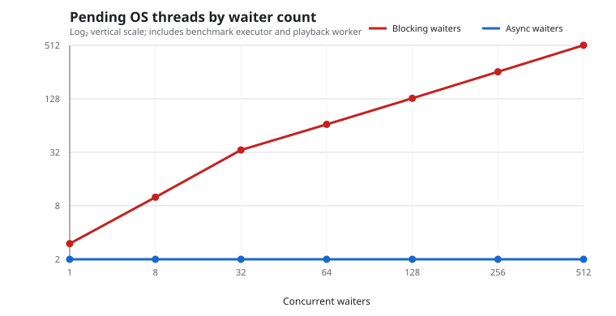

# Resource audit 1: playback completion waiters

## Question and change

The server's non-crossfade completion monitor previously awaited `PlaybackWaiter::wait()` through Tokio's `spawn_blocking`, consuming a blocking-pool worker for each concurrently monitored playback. `PlaybackWaiter::wait_async()` now registers a waker with the captured session and returns a runtime-independent future. The future creates no OS thread, returns the same generation-specific `PlaybackState`, and unregisters when it is dropped. The playback worker architecture is unchanged: each session still has its existing playback worker.

The comparison below isolates the waiter strategy in one binary. The blocking case uses the existing synchronous API with one dedicated waiter thread per playback; it models the per-waiter thread occupancy of the previous adapter, but does not benchmark Tokio itself. The async case polls independent `wait_async()` futures on one small, single-thread executor in the benchmark.

## Method

- Built one optimized release benchmark executable with the workspace's locked dependencies and the local FFmpeg 9.0.2 prefix.
- Each fresh process plays a generated 20 ms WAV into a controlled output that blocks at its first PCM frame until all waiters have started.
- Measured 1, 8, 32, 64, 128, 256, and 512 concurrent waiters. Ran five uninstrumented repetitions and three separate repetitions with a Rust `GlobalAlloc` live-byte counter. Blocking/async order alternated by repetition.
- `completionUs` is elapsed time from releasing the output gate until every waiter returns or polls `Ready`. The table reports median and observed min–max across the five uninstrumented processes.
- Peak RSS and current physical footprint come from `remedia_resources` process snapshots. Rust heap figures are requested live bytes from the separate allocator-instrumented runs, not allocator-reserved or resident bytes.
- Each case checked that every waiter observed `Completed`, output finished, and exactly 960 PCM sample frames per channel were submitted. Async registry and task-waker retention were checked after completion; all counts were zero. Cancellation and drop cleanup are also covered by lifecycle tests.

## Results



| Waiters | Mode | Pending OS threads | Completion µs, median [min, max] | Peak RSS MiB, median [min, max] | Physical footprint MiB while pending, median [min, max] | Rust live heap KiB while pending, median |
| ---: | :--- | ---: | ---: | ---: | ---: | ---: |
| 1 | Blocking | 3 | 61.6 [35.1, 95.0] | 13.44 [13.36, 13.45] | 3.84 [3.75, 3.86] | 14.7 |
| 1 | Async | 2 | 10.0 [9.6, 11.6] | 13.38 [13.31, 13.38] | 3.80 [3.72, 3.80] | 13.4 |
| 8 | Blocking | 10 | 118.1 [99.5, 142.0] | 13.62 [13.53, 13.66] | 3.98 [3.92, 4.02] | 15.9 |
| 8 | Async | 2 | 14.9 [8.5, 16.1] | 13.39 [13.33, 13.39] | 3.78 [3.73, 3.81] | 14.3 |
| 32 | Blocking | 34 | 284.0 [258.7, 297.5] | 14.11 [14.03, 14.14] | 4.44 [4.36, 4.47] | 23.0 |
| 32 | Async | 2 | 14.0 [8.8, 15.5] | 13.39 [13.33, 13.41] | 3.81 [3.75, 3.83] | 17.8 |
| 64 | Blocking | 66 | 550.3 [468.2, 621.0] | 14.59 [14.59, 14.69] | 5.02 [4.94, 5.05] | 30.9 |
| 64 | Async | 2 | 10.5 [9.6, 16.2] | 13.41 [13.34, 13.42] | 3.83 [3.77, 3.84] | 22.4 |
| 128 | Blocking | 130 | 945.9 [912.8, 1231.6] | 15.69 [15.66, 15.72] | 6.11 [6.05, 6.14] | 48.4 |
| 128 | Async | 2 | 17.5 [15.8, 29.8] | 13.36 [13.36, 13.42] | 3.78 [3.77, 3.84] | 31.6 |
| 256 | Blocking | 258 | 2179.5 [1848.4, 3170.4] | 17.81 [17.78, 17.81] | 8.36 [8.30, 8.39] | 83.4 |
| 256 | Async | 2 | 51.5 [23.7, 86.6] | 13.44 [13.36, 13.48] | 3.86 [3.78, 3.89] | 49.9 |
| 512 | Blocking | 514 | 3986.6 [3681.8, 4890.3] | 22.08 [22.03, 22.22] | 12.89 [12.83, 12.91] | 151.6 |
| 512 | Async | 2 | 103.3 [57.5, 127.8] | 13.50 [13.42, 13.52] | 3.91 [3.84, 3.92] | 86.7 |

The registered wakers are the expected pending-future state, not leaked task retention. They were all removed after completion; dropping pending futures also removes their registrations. After the session, waiters, and benchmark objects were dropped, the instrumented Rust live-byte counter returned to its 48-byte process baseline for every case. No native allocator live-byte counter was available, so native heap usage is unmeasured. RSS and physical footprint are process-level measurements and include Rust, native libraries, and runtime overhead.

The largest async completion runs had wider timing spread (for example, 512 waiters ranged from 57.5 to 127.8 µs). These are short controlled-sink measurements on one host, not production deadline or real-time guarantees. They show waiter thread/resource and completion overhead only. They do not measure live Discord/RTP pacing or native heap retention.

## Reproduction

Run from the repository root. The linker flags below accommodate stale dependency paths in this machine's FFmpeg pkg-config metadata; they are command-local and do not change installed dependencies.

```sh
PKG_CONFIG_PATH=/opt/homebrew/opt/ffmpeg/lib/pkgconfig \
RUSTFLAGS='-L native=/opt/homebrew/opt/lame/lib -L native=/opt/homebrew/opt/svt-av1/lib -L native=/opt/homebrew/opt/openssl@4/lib -l c++' \
cargo build --release -p remedia-core --example resource_audit_1

python3 benchmarks/resource-audit-1.py \
  --binary target/release/examples/resource_audit_1 \
  --output benchmarks/resource-audit-1.jsonl \
  --repeats 5 --alloc-repeats 3
```

Raw process results are in `benchmarks/resource-audit-1.jsonl`. The generated input, controlled sink, allocator counter, and executor are in `crates/remedia-core/examples/resource_audit_1.rs`.

## Host and limits

- macOS 27.0.1, arm64, 10 logical CPUs, 24 GiB RAM.
- Rust 1.99.1; FFmpeg libraries reported by pkg-config: libavcodec 61.19.101, libavformat 61.7.103, and libavutil 59.39.100.
- The async benchmark's two pending threads are the benchmark executor and the existing playback worker. The blocking thread count is those same two plus one thread per waiter.
- No scheduler rewrite was attempted: this task measured completion waiters, and did not establish evidence for changing the per-session playback worker model.
